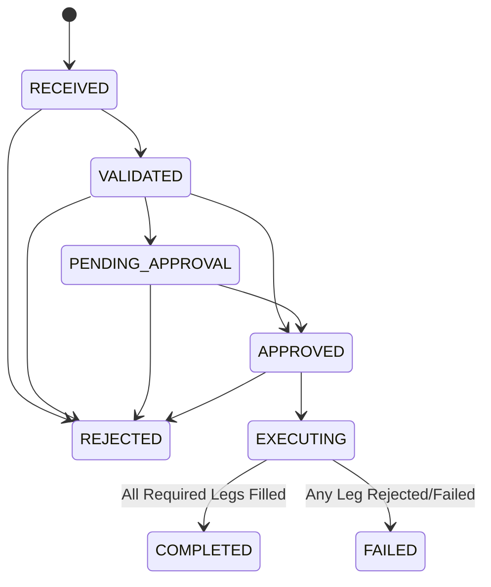
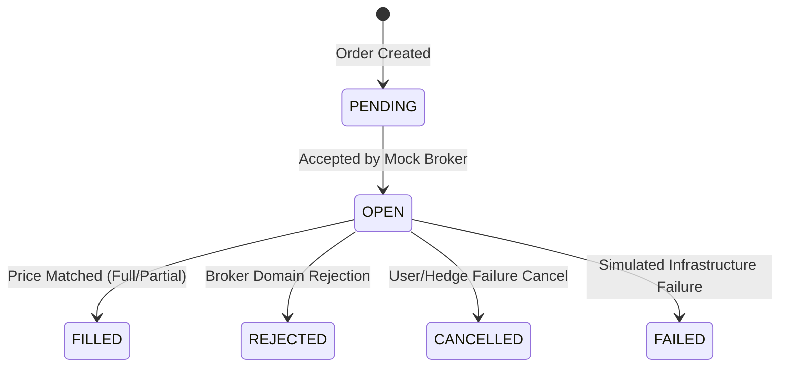

# OpenAlgo - Open Source Algorithmic Trading Platform

<div align="center">

[](https://pepy.tech/projects/openalgo)
[](https://pepy.tech/projects/openalgo)
[](https://twitter.com/openalgoHQ)
[](https://www.youtube.com/@openalgo)
[](https://discord.com/invite/UPh7QPsNhP)

</div>

## What is OpenAlgo?

OpenAlgo is a free, open source, self-hosted **trading platform**, not just a broker bridge. Built on Python Flask + React 19, it gives traders a full-stack environment to **design, host, and execute strategies** through **34 broker plugins**: 33 securities integrations and Delta Exchange for crypto derivatives. Whether you write Python, prefer drag-and-drop, or trade options, OpenAlgo provides a common interface without tying strategy code to one adapter.

OpenAlgo is no longer just "an API layer in front of your broker." Today it combines four trading surfaces in one self-hosted instance, sharing the active broker session, market-data infrastructure, and six operational data stores across the journey from idea to testing and live execution.

## Four Ways to Trade with OpenAlgo

| Surface | Route | Who it's for |
| --- | --- | --- |
| **Unified Broker API** | `/api/v1/` | External platforms: TradingView, Amibroker, ChartInk, Excel, Google Sheets, Python, Java, Go, .NET, Node.js, MetaTrader, GoCharting, N8N. One contract across 34 plugins, with optional operations varying by adapter. |
| **Python Strategy Host** | `/python` | Traders who code: paste any Python script into the in-browser CodeMirror editor, schedule it on IST start/stop times, run multiple strategies in parallel with process isolation, watch real-time logs. No external server, no Docker, no cron. |
| **Flow: No-Code Strategy Builder** | `/flow` | Traders who don't code: drag-and-drop nodes for market data, indicators, conditions, order execution, and notifications. Webhook triggers for TradingView and external signals built in. JSON import/export for sharing strategies. |
| **Options Trading Suite** | `/tools` | Options traders: twelve built-in analytical tools (Strategy Builder with payoff diagrams & live Greeks, Option Chain, IV Smile, Max Pain, Vol Surface, GEX dashboard, OI Tracker, OI Profile, Straddle Chart, Straddle PnL simulator, Option Greeks history). Each one streams from your connected broker. |

Order workflows from the REST API, hosted strategies, and Flow can use Analyzer Mode before live execution. Analytics pages, dashboards, PnL tracking, latency monitoring, notifications, and MCP reuse the same application services where their specific capabilities apply.

## Video Tutorial

[](https://www.youtube.com/watch?v=S5myMo9WUdQ)

## Quick Links

- **Documentation**: [docs.openalgo.in](https://docs.openalgo.in)
- **Installation Guide**: [Getting Started](https://docs.openalgo.in/installation-guidelines/getting-started)
- **Upgrade Guide**: [Upgrade Instructions](https://docs.openalgo.in/installation-guidelines/getting-started/upgrade)
- **Why OpenAlgo**: [Why Build with OpenAlgo](https://docs.openalgo.in/why-to-build-with-openalgo)


## Python Compatibility

**Requires Python 3.12 or newer.**

## Supported Brokers (35 plugins)

<details>
<summary>View All Supported Brokers</summary>

- 5paisa (Standard + XTS)
- AliceBlue
- AngelOne
- Arrow
- Compositedge
- Definedge
- Delta Exchange
- Dhan (Live + Sandbox)
- Firstock
- Flattrade
- Fyers
- Groww
- HDFC Sky
- IBulls
- IIFL
- Iiflcapital
- Indmoney
- JainamXTS
- Kotak Neo
- Motilal Oswal
- Mstock
- Nubra
- Paytm Money
- Pocketful
- RMoney
- Samco
- Shoonya (Finvasia)
- Tradejini
- TradeSmart
- Upstox
- Wisdom Capital
- Zebu
- Zerodha

</details>

Plugins share OpenAlgo's normalized API shapes. Exchange coverage, authentication, market-data entitlement, GTT support, and other optional capabilities still vary by adapter and broker account.

## Core Features

### Unified REST API Layer (`/api/v1/`)
A maintained contract with 57 REST method/path pairs under `/api/v1`:
- **Order Management**: Place, modify, cancel orders, basket orders, smart orders with position sizing
- **Portfolio**: Get positions, holdings, order book, trade book, funds
- **Market Data**: Real-time quotes, historical data, market depth (Level 5), symbol search
- **Advanced**: Option Greeks calculator, margin calculator, synthetic futures, auto-split orders

### Real-Time WebSocket Streaming
- Unified WebSocket proxy server (port 8765 by default)
- Common WebSocket implementation using ZMQ for normalized data across brokers
- Subscribe to LTP, Quote, or Market Depth for any symbol
- ZeroMQ-based message bus for high-performance data distribution
- Automatic reconnection and failover handling

### Flow Visual Strategy Builder (`/flow`)
Build trading strategies visually without writing code:
- **Node-based editor** powered by xyflow/React Flow
- **Pre-built nodes**: Market data, indicators, conditions, order execution, notifications
- **Real-time execution** with live market data
- **Webhook triggers** for TradingView and external signals
- **Condition nodes** with `true/false` and `yes/no` edge handles, `{{var}}` interpolation with list indexing
- **JSON import/export** for sharing strategies between traders
- **Visual debugging** with execution flow highlighting

### Options & Strategy Analytics Tools (`/tools`)
A suite of twelve built-in analytical tools for options trading and market analysis. The pages use the active broker connection; broker market-data entitlements and exchange coverage still apply. Accessible from the **Tools** page in the sidebar:

| Tool | Route | What it does |
|------|-------|--------------|
| **Strategy Builder** | `/strategybuilder` | Build multi-leg option strategies with live Greeks, payoff diagrams, what-if simulators, Strategy Chart, Multi Strike OI tabs, and basket order execution |
| **Strategy Portfolio** | `/strategybuilder/portfolio` | Saved strategies across MyTrades and Simulation watchlists |
| **Option Chain** | `/optionchain` | Real-time option chain with live Greeks, OI data, and quick order placement |
| **Option Greeks** | `/ivchart` | Historical IV, Delta, Theta, Vega, and Gamma charts for ATM options |
| **OI Tracker** | `/oitracker` | Open Interest analysis with CE/PE OI bars, PCR overlay, and ATM strike marker |
| **Max Pain** | `/maxpain` | Max Pain strike calculation with visual pain distribution across strikes |
| **Straddle Chart** | `/straddle` | Dynamic ATM Straddle chart with rolling strike, Spot, and Synthetic Futures overlay |
| **Straddle PnL** | `/straddlepnl` | Simulated intraday ATM straddle P&L with automated N-point adjustments and trade log |
| **Vol Surface** | `/volsurface` | 3D Implied Volatility surface across strikes and expiries using live option chain data |
| **GEX Dashboard** | `/gex` | Gamma Exposure analysis with OI Walls, Net GEX per strike, and top gamma strikes |
| **IV Smile** | `/ivsmile` | Implied Volatility smile with Call/Put IV curves, ATM IV, and skew analysis |
| **OI Profile** | `/oiprofile` | Futures candlestick with OI butterfly and daily OI change across strikes |

Tools use the active broker's REST and WebSocket capabilities. Data availability and supported exchanges vary by plugin and account entitlement.

### API Analyzer Mode
Complete testing environment with ₹1 Crore sandbox capital:
- Test strategies with real market data without risking money
- Pre-deployment testing for strategy validation
- Supports the core MARKET, LIMIT, SL, and SL-M price types
- Realistic margin system with leverage
- Configurable sandbox square-off schedules
- Separate database for complete isolation

[API Analyzer Documentation](https://docs.openalgo.in/new-features/api-analyzer)

### Action Center
Order approval workflow for manual control:
- **Auto Mode**: Immediate order execution (for personal trading)
- **Semi-Auto Mode**: Manual approval required before broker execution
- Complete audit trail with IST timestamps
- Approve individual orders or bulk approve all

[Action Center Documentation](https://docs.openalgo.in/new-features/action-center)

### Python Strategy Host (`/python`)
Host and run your Python strategies directly inside OpenAlgo, with no separate VM, no cron, no Docker:
- Built-in code editor powered by **CodeMirror** with Python syntax highlighting and themes
- Run multiple strategies in parallel with **full process isolation**
- Automated **IST-based scheduling** with start/stop times and per-day-of-week control
- Secure environment variable management with Fernet encryption
- Real-time logs streamed to the browser; state persists across restarts
- Built-in `Python Strategy Guide` page walks first-time users from an empty editor to a scheduled, running strategy

### ChartInk Integration
Direct webhook integration for scanner alerts:
- Supports BUY, SELL, SHORT, COVER actions
- Intraday with auto square-off and positional strategies
- Bulk symbol configuration via CSV
- Real-time strategy monitoring

### AI-Powered Trading (MCP Server)
Connect AI assistants for natural language trading:
- Compatible with Claude Desktop, Cursor, Windsurf, ChatGPT
- Execute trades using natural language commands
- Full trading capabilities: orders, positions, market data
- Local and secure integration with your OpenAlgo instance

### Telegram Bot Integration
Real-time notifications and command execution:
- Automatic order and trade alerts delivered to Telegram
- Get orderbook, positions, holdings, funds on demand
- Generate intraday and daily charts
- Interactive button-based menu
- Receive strategy alerts directly to Telegram
- Secure API key encryption

### Advanced Monitoring Tools
**Latency Monitor**: Track order execution performance and round-trip times across brokers

**Traffic Monitor**: API usage analytics, error tracking, and endpoint statistics

**PnL Tracker**: Real-time profit/loss with interactive charts powered by TradingView Lightweight Charts

[PnL Tracker Documentation](https://docs.openalgo.in/new-features/pnl-tracker)

[Traffic & Latency Monitor Documentation](https://docs.openalgo.in/new-features/traffic-latency-monitor)

### Enterprise-Grade Security
**Password Security**: Argon2 hashing (Password Hashing Competition winner)

**Token Encryption**: Fernet symmetric encryption with PBKDF2 key derivation

**Two-Factor Authentication**: TOTP support with authenticator apps

**Rate Limiting**: Configurable limits for login, API, orders, webhooks

**Manual IP Ban System**: Monitor and ban suspicious IPs via `/security` dashboard

**Browser Protection**: CSP headers, CORS rules, CSRF protection, secure headers, secure sessions

**SQL Injection Prevention**: SQLAlchemy ORM with parameterized queries

**Privacy First**: Zero data collection policy - your data stays on your server

### Modern React Frontend
- **React 19** with TypeScript for type-safe, maintainable code
- **shadcn/ui** components with Tailwind CSS 4.0 for beautiful, accessible UI
- **TanStack Query** for efficient server state management and caching
- **Zustand** for lightweight client state management
- **Real-time updates** via Socket.IO (orders, trades, positions, logs)
- **CodeMirror** for Python and JSON editing with syntax highlighting and themes
- **xyflow/React Flow** for visual Flow strategy builder
- **TradingView Lightweight Charts** for P&L and market data visualization
- Light and Dark themes with 8 accent colors
- Mobile-friendly responsive design

## Supported Platforms

Connect your algo strategies and run from any platform:

- **Amibroker** - Direct integration with AFL scripts
- **TradingView** - Webhook alerts for Pine Script strategies
- **GoCharting** - Webhook integration
- **N8N** - Workflow automation
- **Python** - Official SDK with 100+ technical indicators
- **GO** - REST API integration
- **Node.js** - JavaScript/TypeScript library
- **ChartInk** - Scanner webhook integration
- **MetaTrader** - Compatible with MT4/MT5
- **Excel** - REST API + upcoming Add-in
- **Google Sheets** - REST API integration

Receive your strategy alerts directly to **Telegram** for all platforms.

## Technology Stack

### Backend
- **Flask 3.0** - Python web framework
- **SQLAlchemy 2.0** - Database ORM
- **Flask-SocketIO** - Real-time WebSocket communication
- **ZeroMQ** - High-performance message bus
- **Argon2-CFFI** - Password hashing
- **Cryptography** - Fernet encryption for tokens

### Frontend
- **React 19** - UI library
- **TypeScript** - Type-safe JavaScript
- **Vite 8** - Fast build tool powered by Rolldown
- **Tailwind CSS 4** - Utility-first CSS framework
- **shadcn/ui** - Component library built on Radix UI
- **TanStack Query** - Server state management
- **Zustand** - Client state management

### Data Visualization & Editors
- **TradingView Lightweight Charts** - Financial charts
- **CodeMirror** - Code editor for strategies
- **xyflow/React Flow** - Visual Flow builder
- **Lucide React** - Icon library

### Testing & Quality
- **Vitest** - Unit testing
- **Playwright** - E2E testing
- **Biome** - Linting and formatting
- **axe-core** - Accessibility testing

### Databases
- **SQLite** - 5 databases (main, logs, latency, health, sandbox)
- **DuckDB** - 1 historical market-data store (Historify)

## Official SDKs

OpenAlgo provides officially supported client libraries for application development and system-level integrations:

| Language / Platform | Repository |
|---------------------|------------|
| Python | [openalgo-python-library](https://github.com/marketcalls/openalgo-python-library) |
| Node.js | [openalgo-node](https://github.com/marketcalls/openalgo-node) |
| Java | [openalgo-java](https://github.com/marketcalls/openalgo-java) |
| Rust | [openalgo-rust](https://github.com/marketcalls/openalgo-rust) |
| .NET / C# | [openalgo.NET](https://github.com/marketcalls/openalgo.NET) |
| Go | [openalgo-go](https://github.com/marketcalls/openalgo-go) |

## OpenAlgo FOSS Ecosystem

OpenAlgo is part of a larger open-source trading ecosystem:

- **OpenAlgo Core**: This repository (Python Flask + React)
- **Historify**: Stock market data management platform
- **Official SDKs**: Python, Node.js, Java, Rust, .NET, Go (see above)
- **Excel Add-in**: Direct Excel integration
- **MCP Server**: AI agents integration
- **Chrome Plugin**: Browser-based tools
- **Fast Scalper**: High-performance trading (Rust + Tauri)
- **Web Portal**: Modern UI (NextJS + ShadcnUI)
- **Documentation**: Comprehensive guides on [Gitbook](https://docs.openalgo.in/mini-foss-universe)

## Installation

### Minimum Requirements
- **RAM**: 2GB (or 0.5GB + 2GB swap)
- **Disk**: 1GB
- **CPU**: 1 vCPU
- **Python**: 3.12 or newer
- **Node.js**: 20.20+, 22.22+, or 24.13+ (for frontend development)

### Quick Start with UV

OpenAlgo uses the modern `uv` package manager for fast, deterministic Python environment management:

```bash
# Clone the repository
git clone --filter=blob:none https://github.com/marketcalls/openalgo.git
cd openalgo

# Install UV package manager (if not already installed)
pip install uv

# Configure environment variables from template
cp .env.example .env
# Edit .env with your broker API credentials, or use default MOCK mode for testing

# Synchronize dependencies
uv sync
```

### Running the Services Locally

#### 1. OpenAlgo Flask Core Server & Web Portal
Runs the unified broker REST API (`/api/v1`), broker authentication panel, Flow builder, Python strategy host, and serves the pre-built React frontend:
```bash
uv run app.py
```
*Access in browser at:* `http://127.0.0.1:5000`

#### 2. Phase 2 Quantitative Options Execution Engine
Runs the high-throughput asynchronous execution sequencing engine, margin safety controls, and WebSocket order feeds:
```bash
uv run uvicorn src.main:app --host 0.0.0.0 --port 8000 --reload
```
*Access API docs at:* `http://127.0.0.1:8000/docs` (Health check: `http://127.0.0.1:8000/api/v1/health`)

#### 3. Frontend Development Server (Optional — for UI contributors)
The Flask server already serves the production-ready React app from `frontend/dist/`. To run the Vite hot-module-replacement (HMR) development server:
```bash
cd frontend
npm install
npm run dev
```
*Access Vite dev server at:* `http://localhost:5173`

### Running Tests

Run the test suites using `pytest` via `uv`:

```bash
# Run Phase 2 Execution Engine, Strategy Engine, and Broker Pipeline tests (57 tests)
uv run pytest tests/

# Run specific Phase 2 execution lifecycle test suite
uv run pytest tests/test_execution_flow.py

# Run OpenAlgo core test suite
uv run pytest test/

# Run Frontend unit tests (requires Node.js)
cd frontend && npm run test:run
```

### Linting and Code Quality

```bash
# Python linting and formatting checks (Ruff)
uv run ruff check .

# Frontend linting and formatting (Biome)
cd frontend && npm run check
```

For detailed installation instructions, deployment options (Docker, AWS, etc.), and configuration guides, visit [docs.openalgo.in/installation-guidelines/getting-started](https://docs.openalgo.in/installation-guidelines/getting-started)

## API Documentation

Complete API reference and examples:
- **API Documentation**: [docs.openalgo.in/api-documentation/v1](https://docs.openalgo.in/api-documentation/v1)
- **Symbol Format**: [docs.openalgo.in/symbol-format](https://docs.openalgo.in/symbol-format)

## Key Benefits

- **Guided Installation**: UV and production install scripts with explicit broker configuration
- **Single API, Multiple Brokers**: Switch brokers without code changes
- **No Data Collection**: Complete privacy - your data stays on your server
- **Visual Strategy Builder**: Create strategies with drag-and-drop Flow editor
- **Host Python Strategies**: Run strategies directly without external servers
- **Smart Order Execution**: Intelligent routing for complex strategies
- **Order Splitting**: Automatically split large orders into smaller chunks
- **Real-Time Analytics**: PnL tracking, latency monitoring, traffic analysis
- **Strategy Templates**: Rapid prototyping with pre-built templates
- **Plugin Architecture**: Extensible design for custom integrations
- **Active Community**: Discord support, virtual meetups, open roadmap

## Documentation

Comprehensive documentation is available at [docs.openalgo.in](https://docs.openalgo.in):
- API Reference with examples
- Broker-specific guides
- Security best practices
- Deployment tutorials
- Strategy development guides
- Troubleshooting and FAQs

## Contributing

We welcome contributions! To contribute:

1. Fork the repository
2. Create a feature branch (`git checkout -b feature/amazing-feature`)
3. Commit your changes (`git commit -m 'Add amazing feature'`)
4. Push to the branch (`git push origin feature/amazing-feature`)
5. Open a Pull Request

## Community & Support

- **Discord**: [Join our community](https://www.openalgo.in/discord)
- **Twitter/X**: [@openalgoHQ](https://twitter.com/openalgoHQ)
- **YouTube**: [@openalgo](https://www.youtube.com/@openalgo)
- **GitHub Issues**: [Report bugs or request features](https://github.com/marketcalls/openalgo/issues)

## License

OpenAlgo is released under the **AGPL V3.0 License**. See [License.md](License.md) for details.

## Credits & Acknowledgments

OpenAlgo is built upon the shoulders of giants. We extend our gratitude to all the open-source projects that make this platform possible.

### Core Framework
- **[Flask](https://flask.palletsprojects.com)** - BSD License - Python web microframework
- **[React](https://react.dev)** - MIT License - UI library for building user interfaces
- **[SQLAlchemy](https://www.sqlalchemy.org)** - MIT License - Python SQL toolkit and ORM

### UI Components & Styling
- **[shadcn/ui](https://ui.shadcn.com)** - MIT License - Beautifully designed components built with Radix UI and Tailwind CSS
- **[Radix UI](https://www.radix-ui.com)** - MIT License - Unstyled, accessible UI components
- **[Tailwind CSS](https://tailwindcss.com)** - MIT License - Utility-first CSS framework
- **[Lucide](https://lucide.dev)** - ISC License - Beautiful & consistent icon library

### Data Visualization
- **[TradingView Lightweight Charts](https://github.com/tradingview/lightweight-charts)** - Apache 2.0 - Financial charting library for market data and P&L visualization
- **[Plotly](https://plotly.com/javascript/)** - MIT License - Interactive charting library for options analytics and visualization
- **[xyflow/React Flow](https://reactflow.dev)** - MIT License - Highly customizable library for building node-based visual strategy editors

### Code Editors
- **[CodeMirror](https://codemirror.net)** - MIT License - Versatile code editor for Python and JSON with syntax highlighting
- **[@uiw/react-codemirror](https://uiwjs.github.io/react-codemirror)** - MIT License - CodeMirror React wrapper with themes

### State Management & Data Fetching
- **[TanStack Query](https://tanstack.com/query)** - MIT License - Powerful asynchronous state management
- **[Zustand](https://zustand-demo.pmnd.rs)** - MIT License - Lightweight state management
- **[Axios](https://axios-http.com)** - MIT License - Promise-based HTTP client

### Real-Time Communication
- **[Socket.IO](https://socket.io)** - MIT License - Real-time bidirectional event-based communication
- **[ZeroMQ](https://zeromq.org)** - LGPL License - High-performance asynchronous messaging

### Security
- **[Argon2-CFFI](https://argon2-cffi.readthedocs.io)** - MIT License - Argon2 password hashing (PHC winner)
- **[Cryptography](https://cryptography.io)** - BSD/Apache License - Cryptographic recipes and primitives

### Build & Development Tools
- **[Vite](https://vitejs.dev)** - MIT License - Fast frontend build tool
- **[TypeScript](https://www.typescriptlang.org)** - Apache 2.0 - JavaScript with syntax for types
- **[Biome](https://biomejs.dev)** - MIT License - Fast formatter and linter
- **[Vitest](https://vitest.dev)** - MIT License - Blazing fast unit testing
- **[Playwright](https://playwright.dev)** - Apache 2.0 - End-to-end testing framework

### Additional Libraries
- **[React Router](https://reactrouter.com)** - MIT License - Declarative routing for React
- **[Sonner](https://sonner.emilkowal.ski)** - MIT License - Toast notifications
- **[cmdk](https://cmdk.paco.me)** - MIT License - Command palette component
- **[next-themes](https://github.com/pacocoursey/next-themes)** - MIT License - Theme switching
- **[react-resizable-panels](https://github.com/bvaughn/react-resizable-panels)** - MIT License - Resizable panel layouts
- **[html2canvas-pro](https://html2canvas.hertzen.com)** - MIT License - Screenshot generation

## Repo Activity

## Phase 2: Trade Signal Ingestion System

The Phase 2 Signal Ingestion System receives quantitative trade signals from external strategy engines, strictly validates contracts, assigns unique IDs, persists state with full audit trails, and prevents duplicate processing.

> **CRITICAL ARCHITECTURAL DISCLAIMER (MOCK/SIMULATION ONLY):**
> Execution in this engine is 100% simulated (`MOCK_MODE = True`). It is **NOT** connected to live broker order routing, and real money is **NEVER** risked. All prices, fills, latencies, and portfolio positions are virtual simulations.

### Endpoint Contracts

| Method | Endpoint | Description | Status Code |
| :--- | :--- | :--- | :--- |
| `POST` | `/api/v1/signals` | Ingests a new strategy signal (or deduplicates retries) | `201 Created` / `200 OK` (Duplicate) |
| `GET` | `/api/v1/signals/{signal_id}` | Retrieves signal details with complete status audit history | `200 OK` / `404 Not Found` |
| `GET` | `/api/v1/signals` | Lists & filters signals by `status`, `underlying`, `strategy_name` | `200 OK` |
| `POST` | `/api/v1/signals/{signal_id}/transition` | Explicitly transitions signal status according to state machine | `200 OK` / `400 Bad Request` |
| `POST` | `/api/v1/signals/{signal_id}/execute` | Executes an `APPROVED` signal through the Mock Execution Engine | `200 OK` / `400 Bad Request` |
| `POST` | `/api/v1/signals/{signal_id}/execute-mock` | Executes simulated fill pipeline (`MOCK_ONLY`) | `200 OK` |
| `GET` | `/api/v1/signals/{signal_id}/events` | Retrieves chronological order lifecycle & execution events | `200 OK` |
| `GET` | `/api/v1/mock/positions` | Retrieves simulated positions and realized/unrealized P&L | `200 OK` |

### Signal Status State Machine



### Mock Order Lifecycle & Hedge Dependency Gating



- **Hedge-Before-Short Ordering**: If a leg is flagged with `leg_role="HEDGE"` or is referenced by `depends_on_leg_id`, the engine enforces that the hedge leg must reach `FILLED` before dependent short legs move past `PENDING`. If the hedge leg rejects or fails, dependent legs are automatically transitioned to `CANCELLED` and never submitted to the broker.
- **Sequential Execution**: Multi-leg signals are processed in `execution_sequence` order. Sequence ties are broken deterministically by hedge priority then leg ID. Later sequence groups wait until all current legs reach a terminal state.
- **Pluggable Price & Broker Layer**: `BasePriceProvider` (`MockPriceProvider`) ensures non-violating limit fills, trigger-activated SL orders, and configurable slippage. `BaseMockBrokerClient` isolates order placement for zero-rewrite future broker integration.
- **Atomic Position & P&L Engine**: Every fill atomically updates signed net quantities, calculates realized P&L on position reductions/flips, and tracks mark-to-market unrealized P&L in `mock_positions`.
- **Fault Injector**: Deterministic failure, rejection, and partial fill simulation for automated unit testing (`FaultInjector`).

### Idempotency & Duplicate Prevention

- Invariant enforced at the database level with a unique constraint on `idempotency_key`.
- If an engine retries submission with an existing key:
  - **No duplicate record** is created.
  - Returns `HTTP 200 OK` with `{ "signal_id": "...", "status": "...", "is_duplicate": true }`.

### Strict Validation Rules

1. **Lot Sizes:** Derivatives (`FUTURE`, `OPTION`) on known indices (`NIFTY`, `BANKNIFTY`, `FINNIFTY`, etc.) must have quantities as exact multiples of standard lot sizes.
2. **Prices & Triggers:**
   - `LIMIT` orders require `price > 0`.
   - `SL` orders require both `price > 0` and `trigger_price > 0`.
   - `BUY SL`: limit price must be $\ge$ trigger price.
   - `SELL SL`: limit price must be $\le$ trigger price.
3. **Execution Sequences:** Multi-leg signals must contain contiguous sequences starting from 1 (e.g. `1, 2, 3`) with zero collisions.
4. **Metadata Cap:** Arbitrary metadata payloads are capped at 5KB serialized to prevent abuse.
5. **Safe Logging:** Sensitive credentials, tokens, and keys are automatically masked.

## Disclaimer

**This software is for educational purposes only. Do not risk money which you are afraid to lose. USE THE SOFTWARE AT YOUR OWN RISK. THE AUTHORS AND ALL AFFILIATES ASSUME NO RESPONSIBILITY FOR YOUR TRADING RESULTS.**

Always test your strategies in Analyzer Mode before deploying with real money. Past performance does not guarantee future results. Trading involves substantial risk of loss.

---

Built with by traders, for traders. Making algorithmic trading accessible to everyone.
